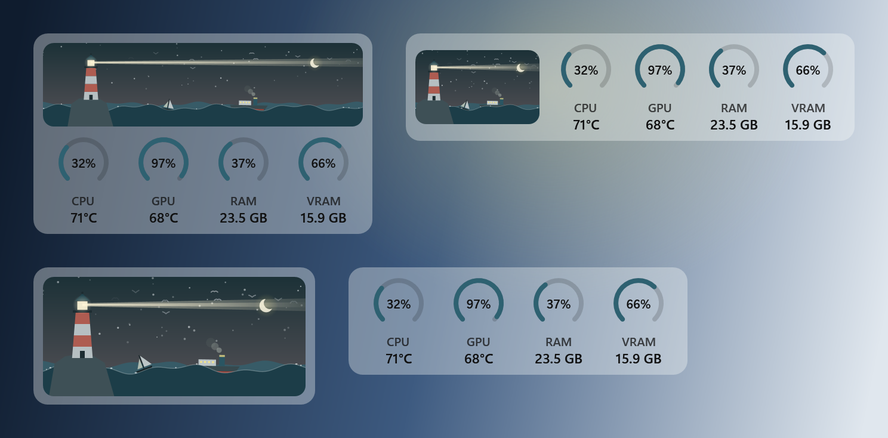

# Lighthouse

<p align="center"></p>

Lighthouse shows how hard your PC is working, right on the Windows 11 taskbar. Two small bars show how busy the
processor (CPU) and graphics card (GPU) are, and change from gray to amber to red as they heat up. Click them to see
which programs are using your PC, how warm it's running, and how it has done over time. It also warns you when
something runs too hot, memory fills up, or a program keeps working hard in the background.

## Install

You need Windows 11 (64-bit) and admin rights once.

1. Get the code: on GitHub, **Code > Download ZIP** and unzip it, or `git clone https://github.com/silkeesmooth/lighthouse`.
2. Open PowerShell in that folder (the one with this README in it) and run:

   ```powershell
   powershell -ExecutionPolicy Bypass -File tools\install.ps1
   ```

3. Click **Yes** on the Windows prompt.

That's it. The script installs the .NET 10 SDK if you don't have it, builds Lighthouse, and sets it up to start
with Windows. Admin rights are needed once because CPU temperatures come from a signed driver (PawnIO), and
Lighthouse installs into Program Files so no other program can swap it out. [SECURITY.md](SECURITY.md) explains
what runs as admin and why.

**To update,** get the new code (`git pull`, or download the ZIP again), then run
`powershell -ExecutionPolicy Bypass -File tools\update.ps1` from the same folder and click **Yes**.

## What you get

<p align="center"></p>

<p align="center"></p>

- **The panel:** an animated harbor scene (its **?** explains each part), four gauges for CPU, GPU, RAM and
  VRAM (click one for its history), and what is using the PC right now.
- **Mini monitor:** a small always-on-top version that moves out of the way of text and fullscreen video.
- **Alerts and health checks:** heat, memory, runaway processes, RAM running below its rated speed, disk wear.
- **Watched jobs:** your own scripts get a row, a boat in the scene, and a notice when they finish.
- **Games:** only critical alerts while you play, and a summary when you stop.
- **Local LLM:** if llama-server, Ollama or LM Studio is running, **What's going on?** asks it to explain the
  last few minutes.
- **Speed test, History and Your week:** speed tests, 90 days of readings, and a Monday summary.
- **Dark mode** is an option too.

## Settings and more

Settings are in a file: tray menu > **Settings file**. Every setting, how each feature works, the diagnostics and
the build commands are in [docs/reference.md](docs/reference.md). [CHANGELOG.md](CHANGELOG.md) lists what changed
and when.

## License

[MIT](LICENSE). The bundled libraries keep their own licenses; see [docs/reference.md](docs/reference.md#license).
