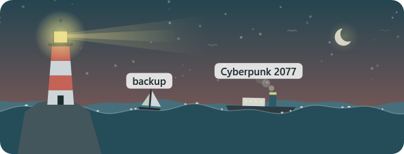
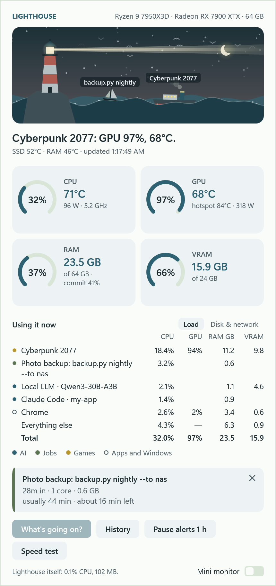
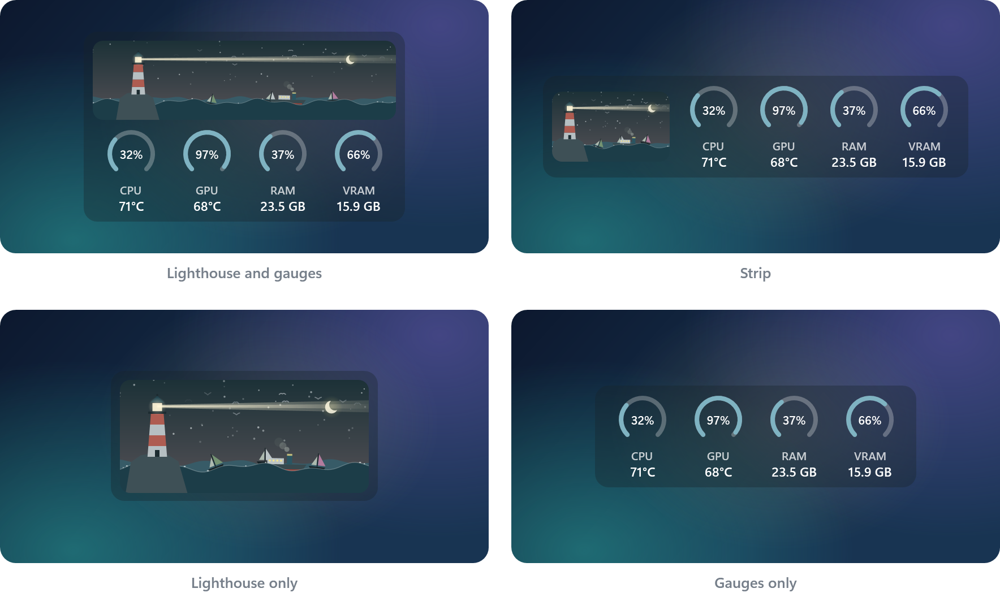

# Lighthouse

Lighthouse shows how hard your PC is working, right on the Windows 11 taskbar. Two small bars show how busy the
processor (CPU) and graphics card (GPU) are, and change from gray to amber to red as they heat up. Click them to see
which programs are using your PC, how warm it's running, and how it has done over time. It also warns you when
something runs too hot, memory fills up, or a program keeps working hard in the background.

## Install

You need Windows 11 (64-bit) and admin rights on the PC.

1. On this page, click **Code > Download ZIP**, then unzip it.
2. In the unzipped folder, double-click **Install**. If Windows warns that the file came from the internet, choose
   **Run** (or **More info > Run anyway**).
3. Click **Yes** when Windows asks for admin rights.

That's it. Install does three things for you:

- downloads the .NET 10 SDK, if your PC doesn't have it (Lighthouse is built with it);
- builds Lighthouse;
- sets Lighthouse to start with Windows.

The first install takes a few minutes.

**Why admin rights?** Lighthouse reads CPU temperatures through a signed driver called PawnIO, which needs admin
rights to install. Lighthouse also installs into Program Files, a folder only administrators can change, so no other
program can tamper with it. [docs/SECURITY.md](docs/SECURITY.md) has the details.

**To update,** download the new ZIP, unzip it, and double-click **Install** again.

## What you get

- **The panel:** an animated harbor scene (its **?** explains each part), four gauges for CPU, GPU, RAM and
  VRAM (click one for its history), and what is using the PC right now.
- **Mini monitor:** a small always-on-top version that moves out of the way of text and fullscreen video.
- **Alerts and health checks:** heat, memory, runaway processes, RAM running below its rated speed, disk wear.
- **Watched jobs:** your own scripts get a row, a boat in the scene, and a notice when they finish.
- **Games:** only critical alerts while you play, and a summary when you stop.
- **Local LLM:** if llama-server, Ollama or LM Studio is running, **What's going on?** asks it to explain the
  last few minutes.
- **Speed test, History and Your week:** speed tests, 90 days of readings, and a Monday summary.
- **Dark mode** is an option too.

## Settings and more

Settings are in a file: tray menu > **Settings file**. Every setting, how each feature works, the diagnostics and
the build commands are in [docs/reference.md](docs/reference.md). [docs/CHANGELOG.md](docs/CHANGELOG.md) lists what changed
and when.

## License

[MIT](LICENSE). The bundled libraries keep their own licenses; see [docs/reference.md](docs/reference.md#license).
