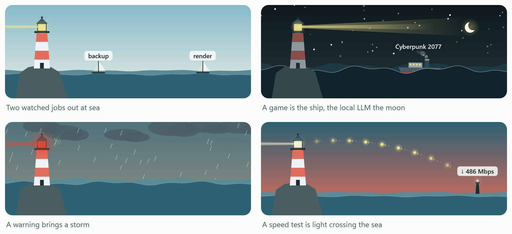

# Lighthouse reference

Everything about Lighthouse in detail. The [README](../README.md) has the short version and the install.

## How it runs

It starts at logon in two parts: the app, with your own rights, and a small sensor helper that runs as admin,
because CPU temperatures need the PawnIO driver. The helper has no window and writes no files; it only answers the
app (see [SECURITY.md](SECURITY.md)). It runs on Windows only: its window, sensors and per-program tracing all
use Windows' own interfaces, so there is no Mac or Linux version.

## The panel

<p align="center"></p>

The flyout has a small animated scene. A lighthouse's beam turns faster with CPU load, the sea rises with RAM
and gets choppier with GPU load, watched jobs and busy programs sail past as boats (each sail in its group's
color from the legend below the list), a game is a ship, a local LLM is the moon, and a speed test is light
crossing the sea. Trouble shows as weather: a storm while a warning is up (with one
lightning flash when a critical alert starts), fog as memory fills, and heat shimmer by the lantern when the CPU
is hot. Gulls fly in with downloads and out with uploads, and foam on the waves follows the disk. Below the scene
you get a one-line headline, four gauges (CPU, GPU, RAM, VRAM; click one for its history) and what is using the
machine right now. Cards under that (alerts, job runs, health checks, results) each have a × that closes them
until Windows restarts, even if they go away and come back, or Lighthouse restarts for an update.

- **What's in the scene:** the scene's **?** opens a legend of each part and what it shows right now.
- **Dark mode:** the switch at the bottom of the flyout. Lighthouse follows Windows' app theme until you switch
  it, then keeps your choice (`theme` in the settings; `"system"` follows Windows again).

**The tray menu** (right-click the icon): Open Lighthouse, Mini monitor, Clicks go through the mini monitor
(while the mini is on), History, Pause alerts for 1 hour, Start with Windows, Task Manager, Settings file, Log
file, and Exit Lighthouse. Windows 11 puts a new tray icon in the hidden-icons overflow; Lighthouse moves its own
onto the taskbar once, and if you hide it again after that, it stays hidden.

**Mini monitor.** The switch at the bottom of the flyout (or "Mini monitor" in the tray menu) shows a small
always-on-top version: the scene and four gauges, or one of the layouts below. Its background panel is see-through (right-click >
See-through background to change how much) and stays at that level under the mouse. The scene and gauges always stay
solid, and each gauge's text is white or black for whatever is behind it. To read what's behind it, the mini
leaves itself out of screen captures, so it won't appear in screenshots or screen shares. Drag it to move
it for now (it snaps to a screen edge dropped near one), double-click it for the full panel, right-click for its menu. It's off
by default and costs about 0.2% of a 16-core CPU while shown.

- **Favorite spot** (right-click > Favorite spot): a corner or the middle of an edge of the main screen, or "Where
  it is now". Bottom right by default. The mini opens there and goes back there.
- **Layouts** (right-click > Layout): the lighthouse over the gauges, a strip with the two side by side, the
  lighthouse only, or the gauges only.
- **Move away from text** (on by default): when text sits under the mini for two seconds, or the typing cursor
  comes near it, it slides to the calmest corner or edge of its screen. It goes back to its favorite spot as soon
  as that spot is clear (two checks a second apart), and the same goes after you drag it somewhere. It moves at
  most once every 10 seconds (a drag counts as a move), never while the mouse is over it, and only to a spot that
  is clearly calmer and doesn't mostly cover where it is or its favorite spot. "Text" is judged from the sharp
  light-to-dark edges in what is behind it, so a plain or blurred wallpaper never moves it.
- **During fullscreen video** (right-click > During fullscreen video): while a fullscreen video, game or slideshow
  covers the mini's screen, it moves to the same favorite spot on another screen, or hides when there is no other
  screen. It comes back when fullscreen ends. "Hide" always hides; "Stay on top" leaves it. A browser's fullscreen
  video counts, YouTube in Chrome or Edge included.
- **Clicks go through the mini monitor** (tray menu): clicks reach the window behind it. It's in the tray menu
  because the mini can't be right-clicked while it's on.

<p align="center"></p>

## What it watches

- **What is using the machine.** The "Using it now" rows add up exactly to the totals on the gauges (CPU,
  RAM, VRAM), with "Everything else" taking the remainder. GPU is the exception: its gauge is the GPU's busiest
  engine, which rows can't add up to, so "Everything else" shows "—" for it. A program's helpers count as the program: the Chrome
  a script drives counts as that script. The dot before each row says which group it is in, and the legend
  under the list names them:
  - **AI** (teal): Claude Code, one row per project folder ("Claude Code · lighthouse (2)" for two sessions), the
    Claude app, a local LLM (llama-server, counting its memory-mapped model as its RAM; Ollama; LM Studio), Codex,
    ChatGPT, Copilot;
  - **Jobs** (green): your own scripts and servers (below);
  - **Games** (amber): anything from a Steam, Epic, EA, Riot, GOG, Ubisoft or Xbox game folder;
  - **Internet** (plum): web browsers: Chrome, Edge, Firefox, Brave, Opera, Vivaldi, Arc;
  - **Apps and Windows** (empty ring): VS Code, Discord, Defender, Windows Update, and so on.

  A switch on the same line shows the list by **Load** (CPU, GPU, RAM, VRAM) or by **Disk & network** (CPU, disk
  MB/s, download and upload Mbps). Disk and network per program come from the sensor helper's kernel trace.
  Without it, disk counts every read and write a program makes, and network shows only the totals.
- **Watched jobs.** List your own scripts under `jobs` in settings.json and each run gets its own row, a boat
  in the scene, a line in the headline, and a toast when it ends that says what its exit code means. Runs under
  a minute are logged without a toast. Each job has:
  - `name`: the row's name;
  - `match`: a regular expression on the command line (case-insensitive);
  - `process` (optional): a regular expression on the program's file name, such as `python`, so a shell that
    launches the job doesn't count as the job;
  - `label` (optional): a regular expression with a `(?<label>...)` group for the row's label. By default the
    label is the command's interesting part: `python -m etl load --since today` reads "load --since today";
  - `exitCodes` (optional): what each exit code means, such as `"3": "could not reach the source"`. 0 is
    "finished" and Ctrl+C is "was interrupted";
  - `notify` (default true): false for servers and helpers, which get a row but no boat or toast.

  Each finished run is kept. Once a job's command (its first word, such as `launch`) has run twice, its card says
  how long it usually takes and about how long is left. At 1.5 times its usual time it says "running longer than
  usual", and the end toast adds "Slower than usual". History lists every run.

  Secrets in a command line never reach a label: the value after `--token`, `--password` or similar, and after
  `API_KEY=`, shows as `•••`.
- **Games.** Only critical alerts toast while a game runs, and you get a session summary when it closes. On a
  dual-CCD X3D Ryzen (7950X3D, 9950X3D), Lighthouse also shows whether AMD's driver parked the non-V-Cache CCD
  for the game. It finds the V-Cache CCD from the L3 sizes Windows reports.
- **A local LLM.** Lighthouse finds llama.cpp's `llama-server`, Ollama and LM Studio. Without one, nothing
  changes except that the Explain controls don't show. With one:
  - **What's going on?** asks it for a short read of the last five minutes. Each card and each "Using it now"
    row (under the mouse) also has an **Explain** link that asks about that one thing. Below the answer you can
    type a follow-up. Answers use only the readings Lighthouse sends, and it only asks a server listening on
    this PC. It is off during a game, so the game keeps the GPU.
  - It uses the model the server already has loaded, so asking doesn't load a second one. A llama-server's key
    is read from its own `--api-key-file` at call time and never stored. Ollama is found where `OLLAMA_HOST`
    says; LM Studio on its default port, 1234 (`lmStudioPort` changes that), with its local server started.
  - If a game starts while the LLM holds the VRAM, a card offers to free it. A llama-server is stopped, and
    Lighthouse puts its exact start command on the clipboard for later, with `runas` when the server ran under
    another account (which asks for that account's password). `llmStartDirectory` sets the folder that command
    starts in (default: the server's own folder). A server running under another account is stopped by the
    sensor helper, which can stop nothing else. Ollama's models are unloaded instead (it loads one again when
    next asked). LM Studio is never stopped: the card asks you to unload its model.
- **Speed test.** The **Speed test** button measures ping, download and upload against Cloudflare's public
  speed-test endpoints (the ones speed.cloudflare.com uses). It takes about 20 seconds and uses at most 700 MB,
  usually much less.
  - While it runs, the scene shows it. Ping rings leave the lamp. For download, gold light comes in from a beacon
    on the far shore; for upload, coral light goes out to it. A faster line sends more light, faster.
  - The panel shows the three numbers as they come in, then the connection: Wi-Fi or Ethernet, the adapter and
    its link speed.
  - If something else on the PC was already downloading or uploading, the result says so, because the test only
    gets what is left.
  - Its × stops a test under way or closes the result.
  - Each result goes into History's Speed tests list and chart. With `internetPlan` set, results say how much of
    the plan you got.
  - Optional daily test (`dailySpeedTest`, off by default). It runs once a day after its time, but only when you've
    been away 10 minutes and no game is running.
  - It's off while a game runs.
- **Alerts** fire only on sustained conditions (20 seconds by default), once per condition, then wait 30 minutes
  and re-arm after it clears. They cover:
  - CPU at 90°C or more (critical at 95°C; set `cpuTempCritical` to 100 on Intel);
  - GPU hotspot at 105°C or more (critical at 110°C), and GPU memory at 100°C;
  - memory nearly full (90% committed);
  - SSD at 70°C;
  - a game short of VRAM while the local LLM holds 8 GB or more of it;
  - a process using more than one core for 15 minutes while you're away;
  - a process that grows steadily by more than 2 GB in 30 minutes.

  Each limit can be changed under `thresholds`.
- **Health checks** run on startup and daily, and toast only when a check newly fails. Each one is left out
  when it doesn't apply to the machine:
  - RAM slower than its kit's rated speed (EXPO or XMP off), read from the part number;
  - on X3D Ryzens, AMD's V-Cache service and Xbox Game Bar present;
  - main display below its maximum refresh rate;
  - GPU idle power (cards that keep VRAM at full clock with two monitors attached);
  - disk space and SSD wear;
  - GPU driver resets;
  - cooling: whether the CPU runs 5 °C or more hotter than a month ago at the same load, from the minute history.

  A failing check's card has a **Don't show again** button; its × only hides it until the check passes.
- **Startup apps.** Lighthouse can keep other apps' startup entries off, for example vendor tools and their
  monitoring pop-ups that updates keep switching back on. List them under `autostartOff`, then run
  `source\tools\autostart.ps1 -Disable` as admin (below). It asks first, and saves the list where only administrators
  can change it. Nothing else is ever touched, and Windows' own entries are refused.
- **Your week.** On Mondays a card sums up the past week: gaming time, temperature peaks, job runs and failures,
  internet speed, alerts. It stays for two days or until closed, and goes into History too.
- **History** goes to `%LOCALAPPDATA%\Lighthouse\history.db`:
  - minute averages for 90 days;
  - events, job runs and speed tests for a year;
  - game sessions.

  It opens inside the flyout, at the flyout's own size: the History button, the tray menu's History, or a click on
  a gauge (which opens that gauge's last hour). The back arrow or Escape returns to the main page. The page has one chart, with
  chips for what it shows (CPU, GPU, RAM, VRAM, or temperatures) and how far back (1 hour, 24 hours, 7 days).
  The line breaks wherever nothing was recorded (the PC was off or asleep), keeps each moment's peak so it
  reaches the "max" under it, and temperatures start near their lowest reading instead of 0. Under the chart, a
  list of Events (alerts, health checks, the local LLM's stops), Games, Jobs or Speed tests, newest first; click a
  row for its detail.

## Settings

Settings live in `%LOCALAPPDATA%\Lighthouse\settings.json` (tray menu > Settings file). After a hand edit, run
`Lighthouse.exe --reload`. To load a file of settings, `Lighthouse.exe --import <file>` copies every setting the
file names into settings.json, keeps the rest, and reloads. [settings.example.json](settings.example.json)
shows the list settings (`jobs`, `workloadNames`, `autostartOff`):

| Setting | What it does |
|---|---|
| `jobs` | Scripts and servers to watch (above). |
| `workloadNames` | Your own names: a process whose file name or path contains `match` gets `label`. |
| `autostartOff` | Startup entries you want off. Kinds: `run` (a Run-key value; `hive` HKLM or HKCU), `task` (a scheduled task; `path` is its folder), `toast` (an app's notifications), `cmdpal` (a PowerToys Command Palette extension, `source\tools\autostart.ps1` only). Lighthouse keeps off only what `source\tools\autostart.ps1 -Disable` saved from this list. |
| `thresholds` | The alert limits, in °C, %, minutes and GB. |
| `llmStartDirectory` | The folder the local LLM's start command changes to. |
| `lmStudioPort` | LM Studio's server port, when it isn't 1234. |
| `quietInGames` | Only critical alerts toast during a game (default true). |
| `usingView` | "Using it now" by `load` or by `io` (disk and network); the flyout's switch sets it. |
| `theme` | `system` (follow Windows), `light` or `dark`; the flyout's Dark mode switch sets it. |
| `sceneLegend` | The scene's legend is open (its **?** sets it). |
| `internetPlan` | `{ "downMbps": 500, "upMbps": 50 }`: speed tests say how much of it you got. |
| `dailySpeedTest` | A daily speed test after this time, such as `"03:30"`, when you're away. Off by default. |
| `jobToastMinSeconds`, `gameSummaryMinMinutes` | Shorter runs and games are logged without a toast. |
| `miniBackgroundOpacity` | How solid the mini monitor's panel is (0 to 1). |
| `miniLayout` | `full`, `strip`, `lighthouse` or `numbers`; the mini's Layout menu sets it. |
| `miniAvoidText` | The mini moves off text (default true). |
| `miniFullscreen` | During fullscreen video: `move` to another screen, or hide without one (default), `hide`, or `stay`. |
| `miniClickThrough` | Clicks go through the mini (default false). |
| `miniFavorite` | Where the mini opens and goes back to: `bottom-right` (default), `bottom`, `bottom-left`, `left`, `top-left`, `top`, `top-right`, `right`, or `custom` for `miniLeft` and `miniTop`. The Favorite spot menu sets it. |
| `dismissedHealth` | Health checks you dismissed. Remove an id to bring it back. |

Keep your own settings in a file outside the repository (`source\state\` is ignored by git) and `--import` it after a
fresh install.

## Build and tests

`Install.cmd` runs these for you. To run them by hand, from the `source` folder:

```powershell
dotnet test
```

GitHub runs the same tests on every push and pull request ([.github/workflows/ci.yml](../.github/workflows/ci.yml)).

```powershell
dotnet publish src\Lighthouse\Lighthouse.csproj -c Release -r win-x64 --self-contained true -p:PublishSingleFile=true -o publish
```

```powershell
Start-Process powershell -Verb RunAs -WorkingDirectory (Get-Location) -ArgumentList '-NoProfile','-ExecutionPolicy','Bypass','-File','tools\setup-admin.ps1'
```

`setup-admin.ps1` is the only elevated step, and it logs to `source\state\setup-<time>.log`. It:
1. installs PawnIO (winget `namazso.PawnIO`), the signed driver LibreHardwareMonitor uses for CPU, RAM and SSD
   sensors;
2. copies the exe and its DLLs to `%ProgramFiles%\Lighthouse`, where only administrators can write;
3. registers two logon tasks: `\Lighthouse\Sensors` runs the sensor helper as admin (5 s after logon), and
   `\Lighthouse\Start at logon` runs the app with your own rights (10 s after logon). Your account can start
   either, which the app does when the helper isn't running, but only an administrator can change them;
4. offers to switch off the startup entries listed under `autostartOff`, if any;
5. starts Lighthouse.

`source\tools\update.ps1` installs a new build over an installed Lighthouse: it builds as you, then asks for admin rights
once to copy it in (`-NoBuild` installs what is already in `publish`). Run it from your own PowerShell, for the
same reason as below.

## Startup apps

`source\tools\autostart.ps1` works on the `autostartOff` list (`-SettingsFile <file>` reads it from another file):
- `-List` shows each entry's state;
- `-Disable` shows the list and asks, then switches them off and records the original state in
  `source\state\autostart-before.json`. It also saves the list in `HKLM\SOFTWARE\Lighthouse`, the only list the
  running Lighthouse keeps off (`-Yes` skips the question);
- `-Restore` puts everything back, clears the saved list and creates
  `%LOCALAPPDATA%\Lighthouse\autostart-guard-off`, so the guard stops.

Windows' own entries are refused whatever the list says: tasks under `\Microsoft\`, Windows Security's Run values
and Windows notifications.

Run it from your own PowerShell. A shell inside a packaged app (the Claude desktop app is one) may get a
private copy of HKCU and AppData, so changes made there never reach Windows.

## Diagnostics

- `Lighthouse.exe --dump-sensors <file>` writes every sensor LibreHardwareMonitor sees.
- `Lighthouse.exe --snapshot <file> [seconds]` samples for a few seconds and writes the snapshot, headline
  and health checks as JSON. Its history stays in memory.
- `Lighthouse.exe --speed-test <file>` runs one speed test and writes every progress report, the time DNS, each
  connection and the first answer took, and the result.
- `Lighthouse.exe --run-speed-test` presses the running copy's Speed test button.
- `Lighthouse.exe --reload` makes the running copy re-read settings.json; `--import <file>` merges a file of
  settings into it first; `--exit` closes the running copy.
- `Lighthouse.exe --render` asks the running copy to save its flyout and mini monitor as `flyout.png` and
  `mini.png` in `%LOCALAPPDATA%\Lighthouse`, and to log how many gauges exist (it should stay flat).
- `Lighthouse.exe --measure <file>` times the CPU cost of the scene, the mini monitor and the flyout, with the
  windows placed off-screen.
- `Lighthouse.exe --gpu-idle <file> <seconds> [label]` appends the GPU's median power, memory clock and load.
- `Lighthouse.exe --text-check <file>` fills the flyout and mini with worst-case values and lists any text that
  would be cut off ("nothing clipped" is the pass). Run it after any layout change.
- `Lighthouse.exe --dismiss <check id>` hides a health check for good, like the card's Don't show again.
- `Lighthouse.exe --sensors` is the sensor helper; its logon task starts it. It exits 30 s after the app goes away.
- `Lighthouse.exe --set-startup on|off` switches both logon tasks (needs admin; the tray menu's "Start with
  Windows" runs it through a UAC prompt).
- `Lighthouse.exe --preview <dir>` draws the scene in 14 situations (storm, fog, gulls, speed test and more), plus
  the gauges and the tray icon zoomed in, as PNGs.
- `Lighthouse.exe --readme-images docs\images` redraws this README's pictures from made-up demo data, so nothing
  from your PC, settings or history ends up in them.
- `Lighthouse.exe --history-image <history.db> <file>` draws the History page from a history file, one picture per
  list and one of temperatures over 7 days. Pass a copy of the file, not the running app's own.
- The log is `%LOCALAPPDATA%\Lighthouse\lighthouse.log`.

## License

Lighthouse is released under the [MIT license](../LICENSE).

The published exe bundles libraries that keep their own licenses:
- [LibreHardwareMonitorLib](https://github.com/LibreHardwareMonitor/LibreHardwareMonitor) and the libraries it
  brings in, MPL-2.0 (HidSharp among them is Apache-2.0);
- Microsoft.Data.Sqlite, MIT, with SQLitePCLRaw, Apache-2.0;
- the .NET runtime, MIT.

PawnIO is installed separately by `setup-admin.ps1` and has its own license.
